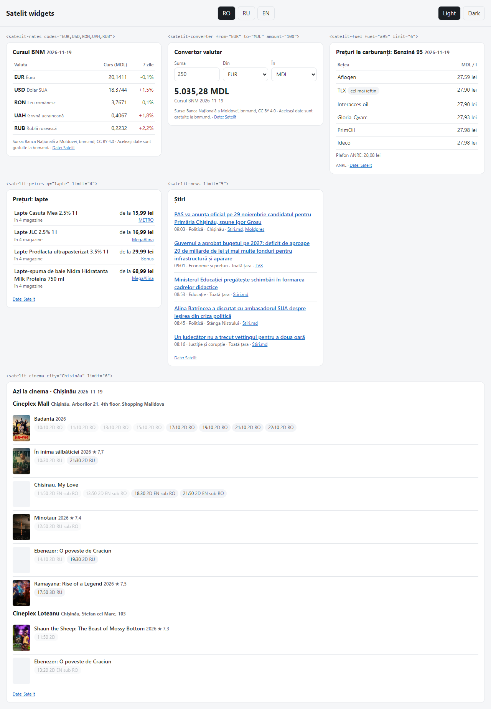

# satelit-widgets

Drop-in widgets with Moldova's data for any website: BNM exchange rates, a currency converter, fuel prices, today's cinema sessions, news and shop prices. One script tag, plain HTML elements, no framework, no build step on your side.



```html
<script src="satelit-widgets.js" data-proxy="https://your-site.md/satelit-proxy"></script>

<satelit-rates codes="EUR,USD,RON"></satelit-rates>
<satelit-converter from="EUR" to="MDL" amount="100"></satelit-converter>
<satelit-fuel fuel="a95" limit="6"></satelit-fuel>
<satelit-cinema city="Chișinău"></satelit-cinema>
<satelit-news limit="5"></satelit-news>
<satelit-prices q="lapte" limit="4"></satelit-prices>
```

The data comes from the [Satelit API](https://developer.satelit.md/en/docs/). The API key must never reach a browser, so the widgets talk to a **small proxy you host**, which holds the key, lets through only the six read routes the widgets need, caches the answers and adds CORS for your sites. Three proxies are included: Node (zero dependencies), Cloudflare Worker, and a single PHP file for shared hosting.

```
browser: <satelit-rates>  ──►  your proxy (key, allow-list, cache, CORS)  ──►  api.satelit.md/v1
```

## Contents

- `dist/satelit-widgets.js`: the built bundle, about 20 kB, **7 kB gzipped**, no dependencies.
- `src/`: its source (`core.js`, `widgets.js`); `npm run build` makes the bundle.
- `proxy/node/`: proxy for Node 18+ (`server.mjs`, `policy.mjs`).
- `proxy/cloudflare-worker/`: the same proxy as a Worker (`src/worker.js`, `wrangler.toml`).
- `proxy/php/satelit-proxy.php`: the same proxy as one PHP file (PHP 7.4+, cURL or `allow_url_fopen`).
- `demo/index.html`: all six widgets, language and theme switches.

## Requirements

- A Satelit API key (a paid plan; see [pricing](https://developer.satelit.md/en/pricing/), keys in the [console](https://developer.satelit.md/en/console/)).
- One place to run the proxy: a Node 18+ server, a Cloudflare account, or any PHP host.
- Browsers with Custom Elements and Shadow DOM (all current browsers).

## Install

1. Copy `dist/satelit-widgets.js` to your site (or serve it from where you host the proxy).
2. Run one of the proxies (below) with your key.
3. Add the script tag with `data-proxy` pointing at the proxy, then place the elements.

### Node proxy

```bash
SATELIT_API_KEY=sat_live_… ALLOWED_ORIGINS=https://your-site.md PORT=8787 node proxy/node/server.mjs
```

| Variable | Default | Meaning |
|---|---|---|
| `SATELIT_API_KEY` | (none) | Your key. Without it the data routes answer 503. |
| `ALLOWED_ORIGINS` | (none) | Comma-separated sites allowed to call it from a browser, or `*`. Other origins get 403 before any API call. |
| `PORT`, `HOST` | `8787`, `127.0.0.1` | Where it listens. Put it behind your web server (`/satelit-proxy/` → `127.0.0.1:8787`), or set `HOST=0.0.0.0`. |
| `BASE_PATH` | (none) | A path prefix, e.g. `/satelit-proxy`, when it is reached under one. |
| `CACHE_MAX` | `500` | Answers kept in memory (LRU). |
| `MISS_LIMIT_PER_MIN` | `60` | Uncached requests per IP per minute; cached ones are never limited. |
| `UPSTREAM_LIMIT_PER_MIN` | `300` | API calls per minute for the whole proxy. |
| `STATIC_DIR` | (none) | Also serve files from this folder (used to run the demo). |

`GET /healthz` reports the cache and the credits left as the API last said (`X-Credits-Remaining`), never the key.

### Cloudflare Worker

```bash
cd proxy/cloudflare-worker
npx wrangler secret put SATELIT_API_KEY      # paste the key, it is stored encrypted
# edit ALLOWED_ORIGINS (and optionally a route) in wrangler.toml
npx wrangler deploy
```

Answers are kept in the Cache API. Cloudflare's Cache API stores nothing on `*.workers.dev`, so give the worker a route or custom domain on your zone (example in `wrangler.toml`). A rate limiting rule on that route is the Worker's counterpart of `MISS_LIMIT_PER_MIN`.

### PHP proxy (shared hosting)

1. Upload `proxy/php/satelit-proxy.php` to your site, e.g. as `/satelit-proxy.php`.
2. Put the key in `satelit-key.txt` **one folder above** the PHP file (outside the web root), or in the `SATELIT_API_KEY` environment variable, or (last resort) in the constant at the top of the file.
3. Set `SATELIT_ALLOWED_ORIGINS` at the top of the file to your site.
4. Use `data-proxy="/satelit-proxy.php"`. The widgets call `/satelit-proxy.php/rates?lang=ro`; where the host turns `PATH_INFO` off, `/satelit-proxy.php?path=/rates&lang=ro` works too.

Answers are cached as files in the system temp folder (or `SATELIT_CACHE_DIR`), written atomically.

## Usage

### Elements and attributes

Every element takes `lang` (`ro`, `ru`, `en`; default: the page's `<html lang>`, else `ro`), `theme` (`light`, `dark`, `auto` = the visitor's system setting; default `auto`), `limit`, and `proxy` (overrides the script's `data-proxy`). Changing an attribute reloads the element.

| Element | Own attributes | Shows | API route (credits) |
|---|---|---|---|
| `<satelit-rates>` | `codes="EUR,USD"`, `limit` (5) | BNM official rates, 7-day change | `/rates` (1) |
| `<satelit-converter>` | `from` (EUR), `to` (MDL), `amount` (100) | Converter on BNM rates, recalculated as you type | `/rates` (1, shared with rates) |
| `<satelit-fuel>` | `fuel` = `a95` \| `diesel` \| `lpg`, `limit` (8) | Networks by price, the cheapest marked, ANRE cap | `/fuel` (1) |
| `<satelit-cinema>` | `city` (all cities when empty), `limit` (6 films per cinema) | Today's sessions per cinema: time, format, audio and subtitles, sold-out, booking link when there is one; past sessions dimmed | `/movies/cinemas/today` (40) |
| `<satelit-news>` | `category`, `region`, `limit` (5) | Latest stories with the outlets that reported them | `/news` (2) |
| `<satelit-prices>` | `q` (required), `limit` (4) | Products matching `q`, lowest price in stock and the shop selling at it | `/prices/search` (3) + `/prices/items/{id}` (2 each) |

Each widget shows the source line the API requires (`meta.attribution`, e.g. BNM's licence line on rates) and a "Date: Satelit" link. Keep them visible.

### Styling

The widgets live in Shadow DOM, so your CSS does not break them. Adjust them from outside with custom properties on the element, or the `::part(box)` selector:

```css
satelit-rates { --sw-accent: #c00; --sw-radius: 4px; }
satelit-news::part(box) { border: 0; padding: 0; }
```

Available: `--sw-bg`, `--sw-fg`, `--sw-muted`, `--sw-line`, `--sw-accent`, `--sw-up`, `--sw-down`, `--sw-chip`, `--sw-radius`.

### Site builders

Any page that accepts a custom `<script>` and HTML can host the widgets, for example an "HTML block" or "custom code" element on Tilda or Wix, or a theme template in an older CMS. Put the script tag and the elements in the same block; the proxy must allow that site's origin (for Wix, the published domain). We tested plain HTML pages in Chrome only (see "Tested with").

### Demo

```bash
SATELIT_API_KEY=sat_live_… STATIC_DIR=. PORT=8787 node proxy/node/server.mjs
# open http://127.0.0.1:8787/demo/index.html
```

`demo/index.html?proxy=https://…` points the demo at another proxy.

## Caching and credits

Every API call costs credits (most 1-5, `/movies/*` 40), so the proxy caches per route, following the API's guidance:

| Route | Cached for |
|---|---|
| `/rates` (BNM publishes once a day) | 3 h |
| `/fuel` | 2 h |
| `/prices/search`, `/prices/items/{id}` | 3 h |
| `/news` | 10 min |
| `/movies/cinemas/today` | 2 h |
| a 404 or 422 answer | 5 min |

- The cache key is the normalized query (known parameters only, sorted), so `?b&a`, `?a&b` and `?a&b&junk` share one entry.
- Concurrent requests for the same uncached answer make **one** API call (Node proxy).
- When the API is down or busy, the last copy is served for up to 24 h past its TTL (`X-Cache: STALE`).
- `<satelit-cinema>` asks for all cities at once and filters in the browser, so every cinema widget on your site shares one 40-credit answer per language per 2 h.
- Browsers may keep an answer for up to 5 min (`Cache-Control: public, max-age≤300`), and the bundle asks once per URL per page (rates and converter share a request).

Order of magnitude, one language, cache always warm: rates 8 + fuel 12 + news 288 + cinema 480 credits a day. A `<satelit-prices>` with `limit="4"` costs 11 credits per distinct `q` every 3 h.

## Security

- The key stays in the proxy (environment variable, Worker secret, or a file outside the web root). It is never sent to the browser, logged, or put in a URL.
- Only six GET routes pass, with checked values; anything else is answered by the proxy (404/422) without calling the API.
- Every API call has a 10-second timeout. A failure shows "data not available" in the widget, never a broken page.
- All data is escaped before it reaches the DOM; only `http(s)` links are rendered.

## Tested with

| What | Version | How |
|---|---|---|
| Node.js (Node proxy, tests, build) | 24.13.0 | `npm test` (24 offline tests), live smoke test, live demo |
| Node.js (offline tests) | 18.20.7, 20.16.0 | `node --test tests/*.test.mjs`: 24 of 24 pass |
| Google Chrome, headless | 157.0.8103.79 | demo page at 1280 px and 390 px, light and dark, ro and ru, against the live API through the Node proxy (cross-origin) |
| Wrangler (`wrangler dev`, local runtime) | 4.93.0 | Worker against the live API: miss then hit from the Cache API, CORS, 403 for another origin, 404 for other routes |
| PHP CLI, built-in server (official `php:8.3-cli` image) | 8.3.36 | `php -l`, unit checks of the allow-list, all six routes live (miss/hit), `?path=` form, bad key (401 envelope, no fatal), no key (503) |

Not tested by us: the Worker deployed on Cloudflare's network, the PHP proxy under Apache/nginx, Firefox and Safari, and the site builders named above.

## Troubleshooting

| You see | Cause |
|---|---|
| "Datele nu sunt disponibile acum." | Inspect the element: its `data-error` attribute holds the reason (`http_403`, `not_configured`, …). |
| 403 `origin_not_allowed` | Add your site's exact origin (`https://www.example.md`, no path) to `ALLOWED_ORIGINS`. |
| 503 `not_configured` | The proxy has no key. |
| 401 `key_invalid` / 402 `plan_required` | The key or the plan; see the [errors page](https://developer.satelit.md/en/errors/). |
| 429 `rate_limited` from the proxy | Too many uncached requests from one IP; cached answers keep working. |
| Worker never shows `X-Cache: HIT` | It runs on `*.workers.dev`; give it a route on your own zone. |
| Cinema widget empty | No sessions today in that city; `city` must match the API's name (diacritics optional: `Balti` = `Bălți`). |

## Development

```bash
npm run build     # src/ -> dist/satelit-widgets.js (prints the gzipped size)
npm test          # offline: policy, Node proxy against a mock API, Worker with mock fetch + Cache, widget rendering
SATELIT_API_KEY=… npm run smoke   # live, about 2 credits
```

The mock API in `tests/mock-api.mjs` serves real answers recorded on 19 Nov 2026 (`tests/fixtures/samples.json`). The three proxies share one allow-list: `proxy/node/policy.mjs` is copied as `proxy/cloudflare-worker/src/policy.js`, and a test checks that both, and the PHP file's routes and TTLs, match.

## Pe scurt (română)

Widgeturi gata de pus pe orice site (HTML simplu, Tilda, Wix, un CMS vechi): cursul BNM, convertor valutar, prețuri la carburanți, seanse de cinema azi, știri și prețuri din magazine. Se pune un `<script>` și elementele `<satelit-…>`; limba (`lang`), tema (`theme`) și numărul de rânduri (`limit`) se aleg din atribute. Cheia API nu ajunge niciodată în browser: stă într-un proxy mic pe care îl găzduiți (Node, Cloudflare Worker sau un singur fișier PHP), care lasă să treacă doar rutele necesare, păstrează răspunsurile în cache (curs 3 h, carburanți 2 h, știri 10 min, cinema 2 h) și adaugă CORS pentru site-urile voastre. Păstrați vizibile linia sursei (de ex. BNM) și linkul „Date: Satelit”.

## License

MIT, see [LICENSE](LICENSE). Copyright (c) 2026 Satelit (satelit.md).
